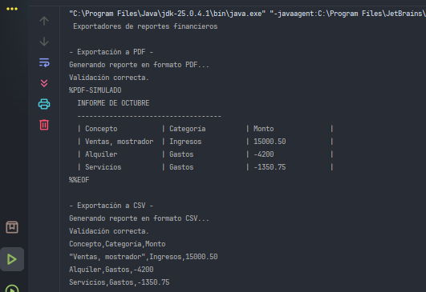
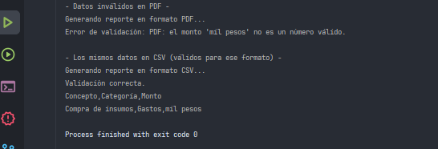

# Ejercicio 04 – Fábrica de exportadores de reportes financieros

## Descripción

Un sistema contable genera informes mensuales que el usuario puede exportar en PDF o CSV. Cada formato tiene sus propias reglas de validación y de maquetado, y los datos deben validarse antes de exportarse.

## Objetivos

- Diseñar un Factory Method que gestione la creación de exportadores con reglas de negocio por formato.
- Combinar la validación previa y la creación del exportador en un método plantilla.
- Encapsular por completo la lógica de formato dentro de cada exportador concreto.

## Implementación del patrón Factory Method

| Rol en el patrón | Clase |
|---|---|
| Producto (interfaz) | `ReportExporter` |
| Productos concretos | `PdfReportExporter`, `CsvReportExporter` |
| Creador (abstracto) | `ReportExporterCreator` (método de fábrica `createExporter()` + método plantilla `generateReport()`) |
| Creadores concretos | `PdfExporterCreator`, `CsvExporterCreator` |
| Datos y errores | `ReportData`, `InvalidReportDataException` |
| Cliente | `Main` |

El método `generateReport(data)` es `final` y sigue siempre el mismo orden: **crear** el exportador (método de fábrica) → **validar** los datos → **exportar**.

## Propósito de la clase

| Clase | Propósito |
|---|---|
| `ReportExporter` | Declara `validate()`, `export()` y `getFormat()`. |
| `PdfReportExporter` | Valida título, filas y montos numéricos; genera un PDF simulado como texto maquetado. |
| `CsvReportExporter` | Valida encabezados, filas y celdas; genera CSV escapando comas y comillas. |
| `ReportExporterCreator` | Define el método de fábrica y el método plantilla que une validación y exportación. |
| `PdfExporterCreator` / `CsvExporterCreator` | Producen el exportador de su formato. |
| `ReportData` | Título, encabezados y filas tabulares del informe (la última columna es el monto). |
| `InvalidReportDataException` | Error lanzado cuando la validación falla. |
| `Main` | Exporta datos válidos en ambos formatos y muestra un caso inválido. |

## Concepto clave

Este ejercicio combina **Factory Method** con **Template Method**: la clase base fija el algoritmo (crear, validar, exportar) y las subclases solo aportan el exportador concreto. Las reglas de cada formato quedan dentro de cada producto, por lo que un mismo dato puede ser válido en CSV pero inválido en PDF.

## Resultado

## Conclusión

Factory Method junto con un método plantilla garantiza que ningún reporte se exporte sin validarse y mantiene la lógica de cada formato aislada. Incorporar un formato nuevo (por ejemplo, XLSX) no modifica el código existente.
